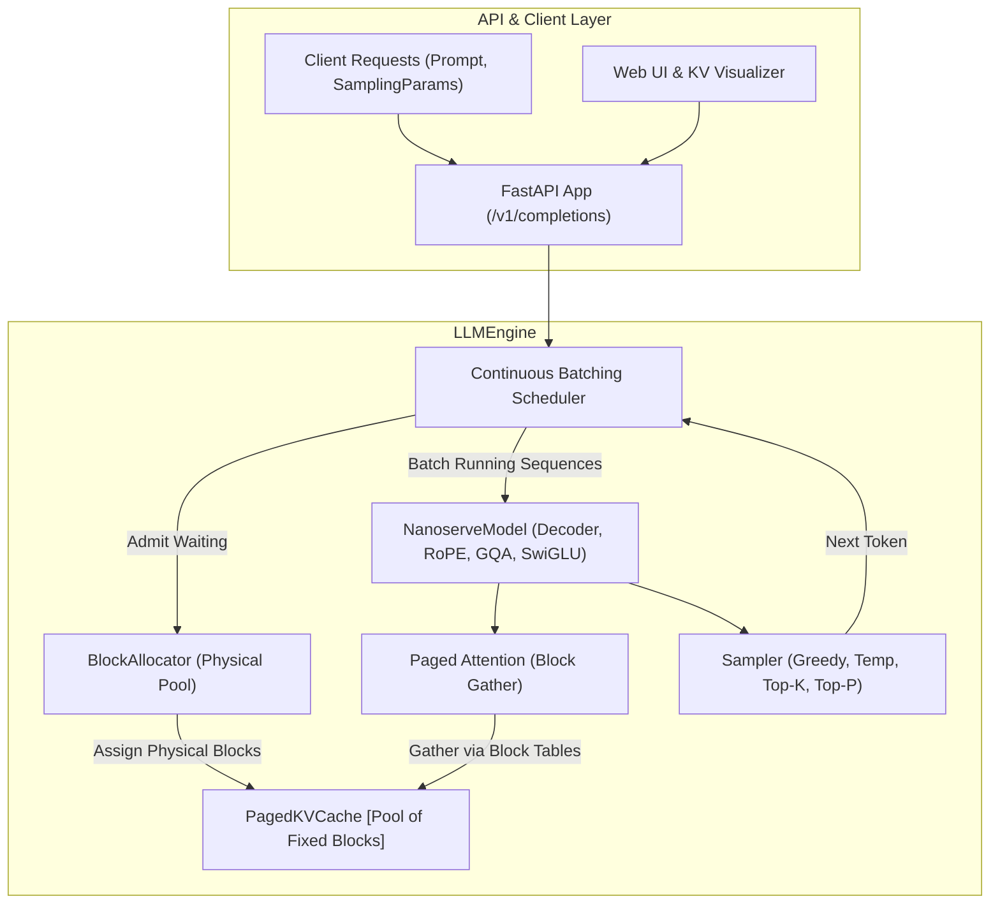
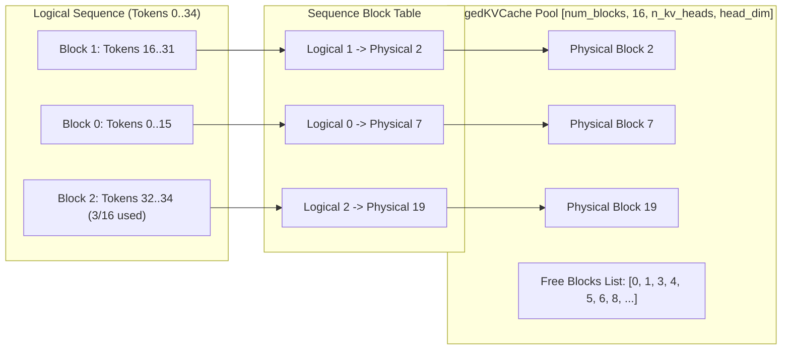
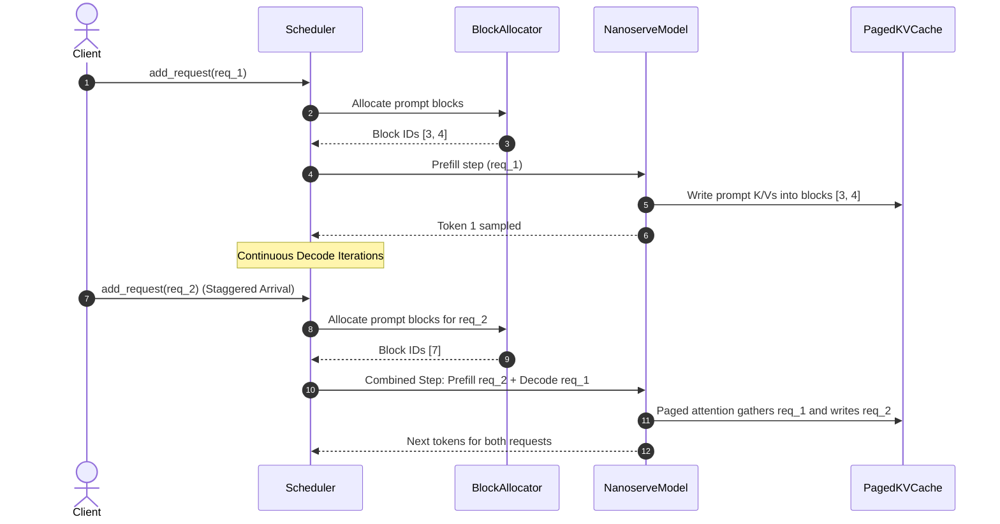

# nanoserve Architecture & Design

> A readable, tested, ~1k-line LLM inference engine that reimplements the core ideas of vLLM (paged KV cache + continuous batching), verified token-exact against HuggingFace and benchmarked on throughput, latency, and memory.

---

## 1. High-Level Architecture

The nanoserve architecture isolates each stage of high-throughput LLM serving into dedicated, composable PyTorch modules:

---

## 2. Paged KV Cache & Memory Management

### The Problem of Contiguous Allocation
In traditional inference setups (e.g., standard HuggingFace static batching), memory for Key and Value activations must be pre-allocated contiguously for each sequence's *maximum* possible length ($S_{max} = 2,048$ or $8,192$). Because actual generation lengths vary widely, this causes:
1. **Severe Internal Fragmentation**: 60–80% of reserved GPU/RAM memory is never written to.
2. **Artificial Concurrency Limits**: The batch size is capped by peak memory reservations rather than active memory usage.

### Nanoserve Solution: Virtual Memory for KV Activations
Inspired by vLLM, nanoserve implements virtual memory paging for KV activations:

- **Block Size Choice ($B = 16$)**: 16 tokens balances gather efficiency with minimal internal fragmentation (at most 15 tokens wasted per sequence, $< 1$ block).
- **Physical Memory Pool**: Allocated once at engine startup as a continuous tensor `[num_layers, num_blocks, block_size, n_kv_heads, head_dim]`.
- **Zero Memory Compaction**: When a request finishes, its physical blocks return immediately to the free list in $O(1)$ time.

---

## 3. Continuous Batching Scheduler

Instead of waiting for an entire batch of requests to reach their respective `EOS` tokens before admitting new requests (static batching), nanoserve schedules inference at the **iteration level**:

### Preemption Policy: Recomputation
If memory is temporarily exhausted (all physical blocks allocated):
1. The scheduler selects the youngest running sequence (`last_admitted`).
2. Its block table is freed and its blocks are returned to the free list.
3. The request's state is set to `PREEMPTED` and it is prepended to the front of the `waiting` queue.
4. When memory frees up, the request is readmitted and its KV cache is recomputed cleanly.

---

## 4. Codebase Line Count & Design Discipline

The core engine is strictly maintained at ~1,000 lines of readable PyTorch code:

| File | Purpose | Lines of Code |
| :--- | :--- | :--- |
| `src/nanoserve/model.py` | Llama/Qwen2 decoder: RMSNorm, RoPE, GQA, SwiGLU | ~340 |
| `src/nanoserve/kv_cache.py` | Contiguous & Paged KV cache, BlockAllocator | ~180 |
| `src/nanoserve/attention.py` | Paged attention decode with block table gather | ~75 |
| `src/nanoserve/scheduler.py` | Continuous batching queues, admission, preemption | ~110 |
| `src/nanoserve/sampler.py` | Greedy, temperature, top-k, top-p with RNG seed | ~80 |
| `src/nanoserve/engine.py` | High-level LLMEngine coordinating inference & metrics | ~160 |
| `src/nanoserve/types.py` | Request, SamplingParams, SequenceState, RequestOutput | ~95 |
| **Total Core Engine** | **Complete Mini LLM Inference Engine** | **~1,040 lines** |

